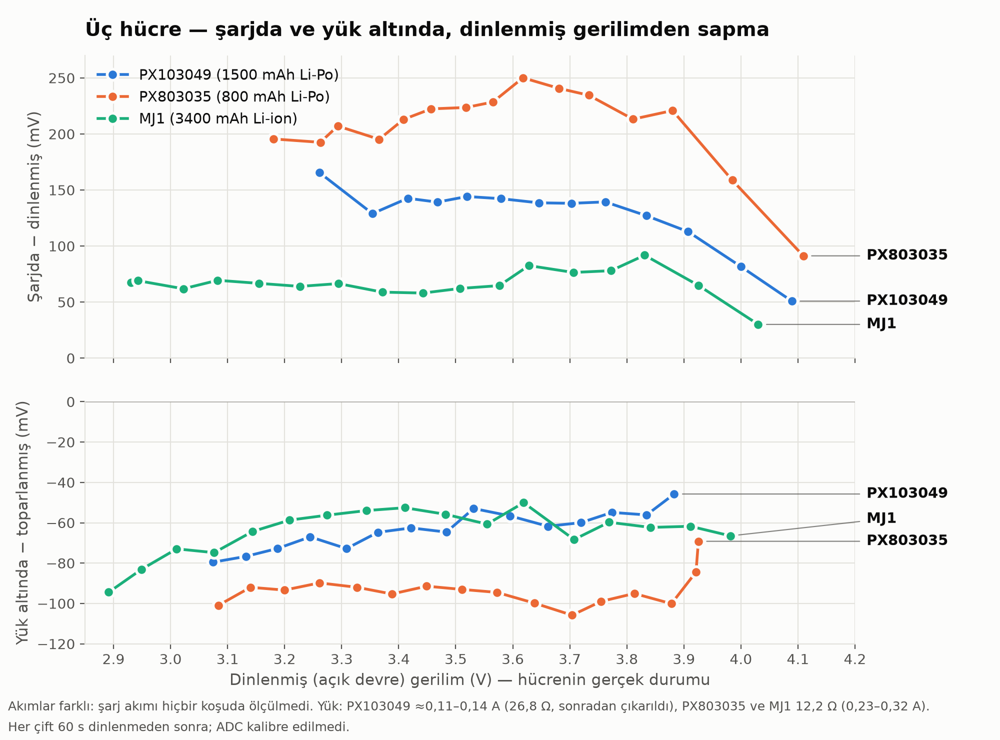
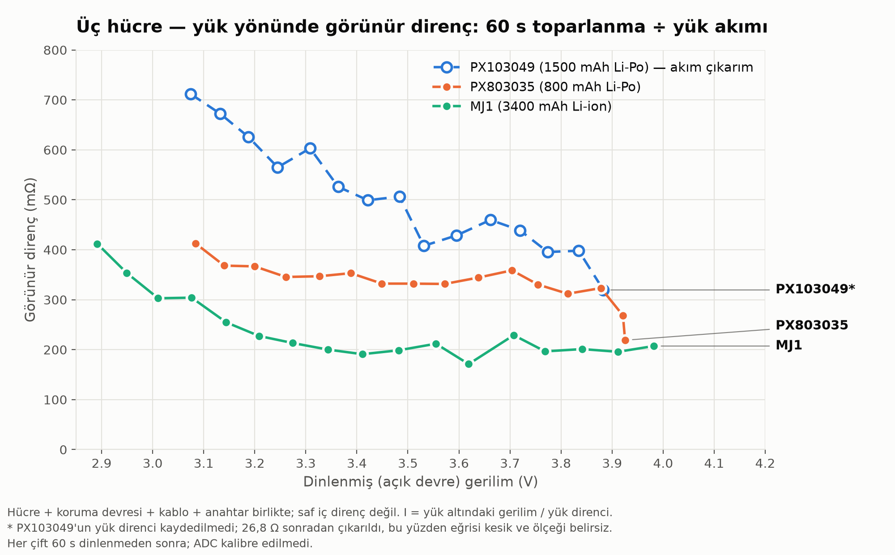

# `karsilastirma` — üç hücre üst üste

Bu dal ölçülen üç hücrenin **dinlenmiş gerilimden sapmalarını** aynı grafikte
gösterir. Her hücrenin ölçüm CSV'si kendi dalından birebir kopyalandı. Hücrelerin
kendi grafikleri, arama tabloları ve ham dump'ları kendi dallarında durur.

**Ölçümün anlatıldığı rapor `main` dalındadır.**

| Hücre | Tür | Dal | Şarj çifti | Yük çifti |
|---|---|---|---|---|
| Power-Xtra PX103049 | 1500 mAh Li-Po | `px103049` | 13 (koşu 1) | 15 |
| Power-Xtra PX803035 | 800 mAh Li-Po | `px803035` | 15 | 16 |
| LG INR18650 MJ1 | 3400 mAh Li-ion (18650) | `inr18650mj1` | 17 | 17 |

## Sapmalar



Yatay eksen her hücrede dinlenmiş (açık devre) gerilim. Hücrelerin yüzde
ölçekleri farklı (Power-Xtra'larda 3,0–4,2 V, MJ1'de 2,8–4,2 V), ama gerilim
ortak bir eksen.

| Hücre | Şarjda − dinlenmiş | Yük altında − toparlanmış | Yük akımı |
|---|---|---|---|
| PX103049 | +51 … +166 mV | −46 … −80 mV | ≈0,11–0,14 A (çıkarım) |
| PX803035 | +91 … +250 mV | −69 … −106 mV | 0,25–0,32 A |
| MJ1 | +30 … +92 mV | −50 … −94 mV | 0,23–0,32 A |

## Görünür direnç (yük yönü)



Yük yönündeki sapma, o andaki yük akımına (`loaded_mv / yük direnci`) bölündü.
Böylece yük akımları farklı olsa da hücreler aynı birimde karşılaştırılabiliyor.

| Hücre | 3,3–3,9 V arası medyan | Aralık |
|---|---|---|
| PX103049 | 439 mΩ | 320–603 mΩ (11 çift), akım çıkarım |
| PX803035 | 332 mΩ | 312–359 mΩ (10 çift) |
| MJ1 | 199 mΩ | 171–229 mΩ (8 çift) |

## Okurken dikkat

- **Şarj sapmaları doğrudan kıyaslanamaz.** Şarj akımı hiçbir koşuda ölçülmedi ve
  her hücrede farklı bir şarj devresi kullanıldı. Sapma, akımla birlikte büyür.
- **PX103049'un yük akımı ölçülmedi.** Koşuda yük direnci kaydedilmedi; 26,8 Ω
  sonradan çıkarıldı. Direnç grafiğinde bu yüzden kesik çizgi ve içi boş
  noktalarla ayrı tutuldu. Ölçeği bu çıkarımın doğruluğuna bağlı.
- **Görünür direnç, saf iç direnç değil.** Hücrenin yanında koruma devresi,
  kablolar ve TPS22919 da içinde. Ayrıca 60 saniyelik toparlanmanın tamamı sayıldı,
  yalnızca anlık düşüş değil.
- **Koşular aynı şartlarda değil.** Farklı günlerde, farklı firmware sürümleriyle,
  sıcaklık kaydı olmadan yapıldı. ADC hiçbir koşuda kalibre edilmedi.
- **MJ1'in şarjı %90'da kesildi.** Kart %95 eşiğinden önce yeniden başladı. Bu
  yüzden MJ1'in şarj eğrisi 4,03 V'ta (dinlenmiş) bitiyor.

## Çalıştırmak

```bash
python -m venv .venv
.venv/Scripts/activate         # Linux/macOS: source .venv/bin/activate
pip install -r requirements.txt
python scripts/compare_cells.py
```

Girdiler `data/<hücre>/measurements-charge.csv` ve `measurements-discharge.csv`.
Çıktılar `graphs/fark_karsilastirma-*` ve `graphs/direnc_karsilastirma-*`; açık
tema, koyu tema ve SVG. Üzerine yazılır ve deterministiktir: veri değişmediyse
SVG'ler dahil bayt bayt aynı çıkar.

Yeni bir hücre eklemek için ölçüm CSV'lerini `data/<hücre>/` altına koy ve
`scripts/compare_cells.py` başındaki `CELLS` listesinin **sonuna** ekle. Renkler
sıraya göre verildiği için mevcut hücrelerin rengi değişmez.

## Depodaki dallar

| Dal | Ne taşır |
|---|---|
| `main` | Rapor: Power-Xtra hücrelerinin verisi, tabloları, grafikleri ve anlatımı |
| `px103049` | PX103049 (1500 mAh Li-Po) |
| `px803035` | PX803035 (800 mAh Li-Po) |
| `inr18650mj1` | LG INR18650 MJ1 (3400 mAh Li-ion) |
| **`karsilastirma`** | **Üç hücre üst üste — burası** |
| `archive/sarj`, `archive/ikinci-olcum` | eski ölçüm dalları, pasif |
