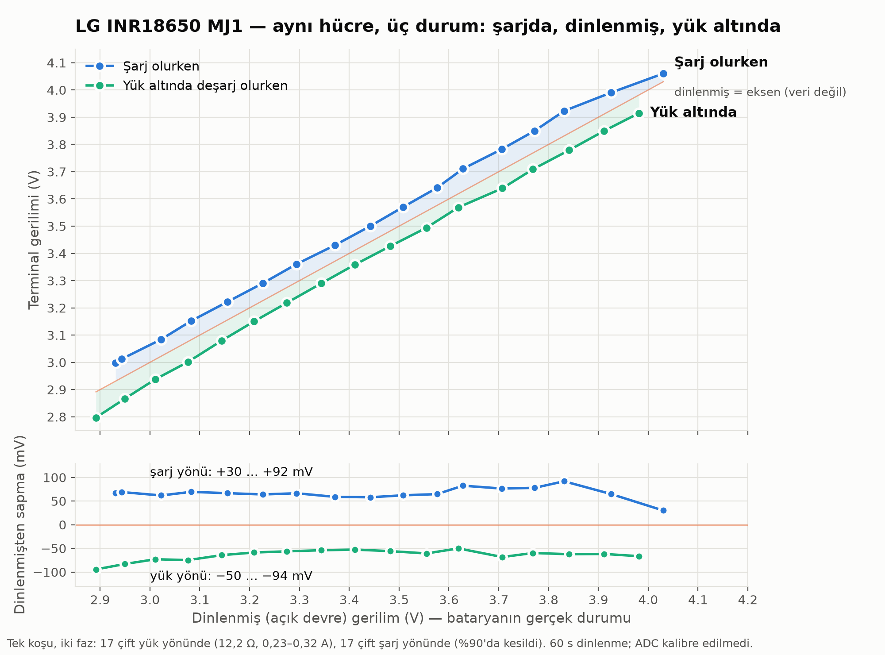

# `inr18650mj1` — LG INR18650 MJ1 (3,635 V / 3400 mAh Li-ion)

Bu dal **yalnızca bu hücreye** aittir: kendi ölçüm verisi, kendi grafikleri ve
`BATTERY` bloğu bu hücreye ayarlanmış script. Önceki hücrelerin dosyaları kendi
dallarında (`px103049`, `px803035`).

**Ölçümün anlatıldığı rapor `main` dalındadır.**

## İlk koşu

Tek koşu, iki faz. Veri kartın Wi-Fi'sinden `/dump` ile 5 Ekim 2026'da çekildi:
[`data/raw_dump-mj1.log`](data/raw_dump-mj1.log), hiç düzenlenmedi.

| | Deşarj (faz 1) | Şarj (faz 2) |
|---|---|---|
| Çiftler | 17, eşik %80 → %0 | 17, eşik %10 → %90 |
| Başlangıç | 3985,75 mV (dinlenmiş) | 2920,06 mV (dinlenmiş) |
| Son çift | yük altında 2797 mV, toparlanınca 2892 mV | şarjda 4060 mV, dinlenince 4030 mV |
| Dinlenmişten fark | −50 … −94 mV, alt uçta büyüyor | +58 … +92 mV, son çiftte +30 mV |
| Anahtar kapalı süre | 10,1 saat | 8,9 saat |
| Akım | 0,23–0,32 A (`loaded_mv / 12,2 Ω`) | ölçülmedi |

- **Çekilen kapasite:** Deşarj fazında akımı `loaded_mv / 12,2 Ω` ile hesaplayıp
  süreyle çarpınca yaklaşık **2890 mAh** çıkıyor (3,99 V → yük altında 2,80 V).
  Koşu dolu hücreyle değil %85 civarından başladığı için etiketteki 3400 mAh'in
  altında kalması bekleniyor.
- **Şarj tamamlanmadı:** Kayıt `state=CHARGING` olarak kalmış. Kart şarj fazının
  8,9. saatinde, %95 eşiğinden önce yeniden başladı. Firmware koşuyu reset sonrası
  sürdürmediği için %95 ve %100 çiftleri yok.
- **ADC kalibre edilmedi:** Mutlak değerler multimetreyle karşılaştırılmadı.

| Dosya | İçerik |
|---|---|
| `data/raw_dump-mj1.log` | Cihazdan alınan ham çıktı |
| `data/measurements-discharge-mj1.csv` | Faz 1, yük yönünde 17 çift |
| `data/measurements-charge-mj1.csv` | Faz 2, şarj yönünde 17 çift |
| `data/lookup-discharge-mj1.csv` | Yük altındaki gerilimden dinlenmiş karşılığı (10 mV adım) |
| `data/lookup-charge-mj1.csv` | Şarjdaki gerilimden dinlenmiş karşılığı (10 mV adım) |
| `graphs/state_overlay-mj1-*` | Üç durum üst üste |
| `graphs/voltage_overlay-mj1-*` | Şarj yönü ayrıntısı |
| `graphs/discharge_overlay-mj1-*` | Deşarj yönü ayrıntısı |



## Hücre

| | Değer | Kaynak |
|---|---|---|
| Model | LG INR18650 MJ1, 18650 Li-ion (NMC) | sargı etiketi |
| Kapasite | 3400 mAh minimum / 3500 mAh tipik | etiket `3.40Ah` / datasheet |
| Nominal gerilim | 3,635 V | datasheet |
| Şarj | 4,20 V ± 0,05 V CC-CV | datasheet |
| Deşarj alt sınırı | 2,50 V | datasheet |
| Koruma | hücre üstünde koruma PCB'si var | fotoğraf |

## Firmware ayarı (`tps22919_switch_test/include/BatteryConfig.h`)

Düzenek aynı: ESP32 + iki TPS22919 (GPIO4 yük, GPIO17 şarj) + 10 kΩ/10 kΩ bölücü
(GPIO32) + 12,2 Ω dummy load. PX803035'e göre değişenler:

| Sabit | PX803035 | MJ1 | Neden |
|---|---|---|---|
| `EMPTY_MV` | 3000 | **2800** | Li-ion 2,5 V'a kadar iner; güvenlik tabanları ölçeğin altında kalmak zorunda |
| `DISCHARGE_CUTOFF_MV` | 2500 | **2600** | taban sırası: inhibit < cutoff < validity |
| `LOAD_INHIBIT_MV` | 2400 | **2500** | datasheet alt sınırının altına hiç yük bağlanmaz |
| `MIN_VALID_MV` / `MAX_VALID_MV` | 2700 / 4250 | aynı | 4250 = şarj toleransının üst ucu |
| `MAX_CHARGE_STAGE_MS` | 2 saat | **6 saat** | düz platoda tek 70 mV'luk basamak 2–3 saat sürebilir |
| `MAX_RUN_MS` | 24 saat | **48 saat** | ≈12 saat deşarj + şarj (şarj cihazına bağlı) |

Gerilim ölçeği 2,80–4,20 V, adım %5 = 70 mV. PX803035'in ayarı
`BatteryConfig.h.px803035` dosyasında duruyor.

12,2 Ω yük bu hücrede 0,23–0,34 A (≈0,1C) çeker, tam deşarj 11–12 saat sürer. Yük
direnci değiştiyse yeniden ölçüp hem firmware'e hem `BATTERY["load_ohms"]`'a yaz.

## Çalıştırmak

```bash
python -m venv .venv
.venv/Scripts/activate         # Linux/macOS: source .venv/bin/activate
pip install -r requirements.txt
python scripts/plot_voltage.py
```

Girdi iki ölçüm CSV'si: `data/measurements-discharge-mj1.csv` ve
`data/measurements-charge-mj1.csv`. İkisi de ham dump'taki `# PHASE` bloklarının
birebir kopyası. Yoksa script ne eksik olduğunu söyleyip çıkar. Çıktılar
`graphs/*-mj1*` ve `data/lookup-*-mj1.csv`; üzerine yazılır.

`BATTERY` bloğundaki eksen sınırları, notlar ve dipnotlar bu koşunun verisine göre
ayarlı. Yeni bir koşu eklenirse yeniden bakılmalı.

## Depodaki dallar

| Dal | Ne taşır |
|---|---|
| `main` | Rapor: ölçülen bataryaların verisi, tabloları, grafikleri ve anlatımı |
| `px103049` | PX103049 (1500 mAh Li-Po) |
| `px803035` | PX803035 (800 mAh Li-Po) |
| **`inr18650mj1`** | **LG INR18650 MJ1 (3400 mAh Li-ion) — burası** |
| `archive/sarj`, `archive/ikinci-olcum` | eski ölçüm dalları, pasif |
